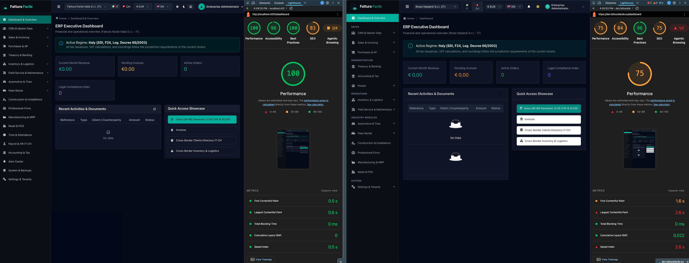

# Fattura Facile — Web Frontend (Inglorious)

The web frontend of **Fattura Facile**, the cross-border Italy–Switzerland invoicing and management app. It is a port of the [Angular frontend](https://github.com/FatturaFacile/web-frontend) to [Inglorious Web](https://inglorious.dev/web/) and the rest of the Inglorious ecosystem.

It covers the same screens, uses the same backend API and has the same translations as the Angular app. It ships about a fifth of the initial JavaScript and CSS, and its feature code is about a third smaller. See [Benchmarks](#benchmarks).

## The technology

[Inglorious Forge](https://inglorious.dev) is a complete ecosystem for building web apps and video games. It covers state management, rendering, routing, a design system, internationalization, pre-rendered sites, and even a game engine. All of it rests on one model taken from game development (Entity–Component–System): **state lives in plain-data entities, and behavior lives in types**.

- An **entity** is a plain object in the store, such as `{ type: "Session", status: "checking", user: null }`.
- A **type** is an object of event handlers, plus an optional `render`. Handlers update their entity (immutably, through [mutative](https://github.com/unadlib/mutative)) when an event is notified. Types can be composed: a page is often an array like `[behavior, requireAuth]`.
- **Events** are notified with `api.notify("event", payload)` and reach every entity whose type handles them. This means there are no services, no dependency injection and no RxJS. Cross-cutting concerns such as an expired session or a failed request are just events.

This app uses these parts of the ecosystem:

| Package                                                                | Role in this app                                                                                                                                                                                                        | Docs                                                                                          |
| ---------------------------------------------------------------------- | ----------------------------------------------------------------------------------------------------------------------------------------------------------------------------------------------------------------------- | --------------------------------------------------------------------------------------------- |
| [`@inglorious/store`](https://www.npmjs.com/package/@inglorious/store) | A Redux-compatible, ECS-inspired store. It holds every entity, with middlewares for transitions and requests.                                                                                                           | [inglorious.dev/store](https://inglorious.dev/store/)                                         |
| [`@inglorious/web`](https://www.npmjs.com/package/@inglorious/web)     | Connects the store to [lit-html](https://lit.dev/docs/libraries/standalone-templates/) so that types render UI. It also provides the router (with lazy routes), forms and sensors (such as `MediaQuery` for dark mode). | [inglorious.dev/web](https://inglorious.dev/web/)                                             |
| [`@inglorious/ui`](https://www.npmjs.com/package/@inglorious/ui)       | The design system: DataGrid, Drawer, Menu, Combobox, Toast and more. It has themes (Bootstrap is used here) with light and dark modes, and view transitions.                                                            | [inglorious.dev/ui](https://inglorious.dev/ui/)                                               |
| [`@inglorious/i18n`](https://www.npmjs.com/package/@inglorious/i18n)   | Translations driven by the store and built on i18next. Each language catalogue (it, en, de, fr) is loaded on demand.                                                                                                    | [README](https://github.com/IngloriousCoderz/inglorious-forge/tree/main/packages/i18n#readme) |

Everything else the ecosystem offers is documented at [inglorious.dev](https://inglorious.dev), and the source code is in the [inglorious-forge](https://github.com/IngloriousCoderz/inglorious-forge) monorepo.

### What a page looks like

Most read-only sections are a single factory call. This is the whole HR page:

```ts
import { html } from "@inglorious/web"

import { listEmployees } from "../../api/hr"
import { renderTag } from "../../layout/tag"
import type { Employee } from "../../models/hr"
import { createListPage } from "../../types/list-page"

export const HrPage = createListPage(
  listEmployees,
  (columnId, employee: Employee) => {
    switch (columnId) {
      case "name":
        return html`<strong>${employee.name}</strong>`
      case "regime":
        return renderTag(
          employee.regime,
          employee.regime.includes("Frontaliere") ? "secondary" : "info",
        )
      case "status":
        return renderTag(employee.status, "success")
    }
  },
)

export default HrPage
```

### Coming from the Angular app

| Angular                                    | Here                                                                                                    |
| ------------------------------------------ | ------------------------------------------------------------------------------------------------------- |
| Components (`@Component`, templates, SCSS) | Types with a `render` that returns a lit-html `html` template, plus plain CSS                           |
| Injectable services, NgRx Signal Store     | Entities in one store, with event handlers on their types                                               |
| HTTP interceptors                          | A `fetch` wrapper ([src/api/http.ts](src/api/http.ts)) that turns failures into a `requestFail` event   |
| Route guards                               | Composable types ([src/guards](src/guards/)) such as `requireAuth`                                      |
| `loadComponent` lazy routes                | `() => import("../pages/x")` in [src/store/routes.ts](src/store/routes.ts), one chunk per page          |
| ng-zorro                                   | `@inglorious/ui`, with a custom theme that meets WCAG AA ([src/styles/theme.css](src/styles/theme.css)) |
| Font Awesome webfonts                      | Tree-shaken SVG icons from Iconify packages                                                             |
| `@angular/service-worker`                  | [vite-plugin-pwa](https://vite-pwa-org.netlify.app/) ([src/pwa.ts](src/pwa.ts))                         |

In many places the Angular app faked data or success when a request failed (backups, alerts, the QR-bill form and others). The port reports those failures instead.

## Getting started

Requirements: **Node ≥ 26** and **pnpm 12** (pinned in `packageManager`, so Corepack picks the right version).

```sh
pnpm install
pnpm dev
```

The dev server starts on **http://localhost:4200** and proxies `/api` and `/sanctum` to the backend, so the Sanctum session and XSRF cookies are first-party.

- **Port 4200 is required.** The backend's `SANCTUM_STATEFUL_DOMAINS` trusts only that origin. From any other port the login succeeds, but every later request answers 401. For the same reason, this app and the Angular dev server can't run at the same time.
- **HTTPS** is turned on automatically when mkcert certificates exist at `../certs/localhost.crt` and `../certs/localhost.key`.

### Configuration

Set these through a `.env.local` file or the environment:

| Variable               | Default                        | Purpose                                    |
| ---------------------- | ------------------------------ | ------------------------------------------ |
| `VITE_BACKEND_URL`     | `https://api.fatturafacile.eu` | The backend that the dev server proxies to |
| `VITE_API_BASE_URL`    | `/api/v1`                      | The API base URL used by the app           |
| `VITE_CSRF_COOKIE_URL` | `/sanctum/csrf-cookie`         | The Sanctum CSRF cookie endpoint           |

## Scripts

| Command          | What it does                                              |
| ---------------- | --------------------------------------------------------- |
| `pnpm dev`       | Starts the Vite dev server, with HMR for Inglorious types |
| `pnpm build`     | Creates the production build in `dist/`                   |
| `pnpm preview`   | Serves the production build on port 4200                  |
| `pnpm test`      | Runs the Vitest unit tests and the jsdom smoke tests      |
| `pnpm typecheck` | Runs strict TypeScript without emitting files             |
| `pnpm lint`      | Runs ESLint with `@inglorious/eslint-config`              |
| `pnpm format`    | Runs Prettier                                             |
| `pnpm bench:*`   | Runs the benchmarks (see [benchmarks/](benchmarks/))      |

Most smoke tests ([src/app.test.ts](src/app.test.ts)) start the whole app in jsdom against a stubbed `fetch` and use it the way a user would.

## Deployment

Every push to `main` runs [.github/workflows/deploy.yml](.github/workflows/deploy.yml): lint, typecheck, tests and build, then the build goes live at **https://inglorious.fatturafacile.eu**.

- The site is served by the dev stack on the VPS (see `deploy/dev/` in the web-api repo), with the dev API on the same origin (`/api`, `/sanctum`), so the Sanctum cookies are first-party.
- Secrets live in the GitHub Environment `inglorious` (`DEPLOY_SSH_HOST`, `DEPLOY_SSH_USER`, `DEPLOY_SSH_KEY`, `DEPLOY_SSH_KNOWN_HOSTS`). The SSH key is restricted on the server to [deploy/server-deploy.sh](deploy/server-deploy.sh), which only replaces the site files.

## Project structure

```
src/
  main.ts           Entry point: global styles, PWA, start()
  start.ts          Wires request failures to the store and mounts the app (also used by the tests)
  app.ts            Root render: theme, session state, shell or public route
  config.ts         API URLs and the home and login paths
  store/            createStore, the initial entities, middlewares and the route table
  pages/            One folder and one lazily loaded chunk per routed page
  types/            Shared Inglorious types and factories (list pages, server grids, resource pages and forms…)
  layout/           Render helpers: page header, KPIs, tags, grid toolbar, formatting
  api/              A typed client for each backend area, on top of the fetch wrapper
  models/           Domain types (invoices, contacts, treasury…)
  forms/            Validation and server-side error mapping
  guards/           Route guards as composable types
  i18n/             i18n setup and the it/en/de/fr catalogues
  styles/           The Fattura Facile theme on top of Inglorious UI's Bootstrap theme
types/              TypeScript declarations for the app's entities, state and API
benchmarks/         Scripts that compare this app with the Angular app
```

Don't confuse `src/types/` with `types/`. The first holds Inglorious **types**, which define behavior. The second holds TypeScript type declarations.

Paths of the Angular app that weren't ported fall through to a "not ported" page.

## Benchmarks

Both apps were measured on the same machine on 2026-11-03. The full report, including where Angular comes out ahead, is in [BENCHMARKS.md](BENCHMARKS.md).

|                                  |  Angular | Inglorious | Ratio |
| -------------------------------- | -------: | ---------: | ----: |
| Initial JS + CSS, gzip           | 389.5 kB |    82.6 kB | 0.21× |
| All JS + CSS, gzip               | 544.2 kB |   191.8 kB | 0.35× |
| Lighthouse mobile performance    |       89 |         99 |       |
| Lighthouse accessibility         |       95 |        100 |       |
| Mobile LCP                       | 3,530 ms |   1,832 ms | 0.52× |
| Feature lines of code            |    8,301 |      5,314 | 0.64× |
| Framework and library API in use |      129 |         51 | 0.40× |
| Production build                 |   ~4.0 s |     ~1.4 s | 0.36× |
| Dev server ready (warm)          |   ~2.3 s |     ~0.3 s | 0.14× |



The screenshot shows the same signed-in dashboard in both apps, each next to a Lighthouse report from Chrome DevTools. **Inglorious is on the left and Angular is on the right.**

|                          | Inglorious (left) | Angular (right) |
| ------------------------ | ----------------: | --------------: |
| Performance              |               100 |              75 |
| Accessibility            |                96 |              84 |
| Best Practices           |               100 |              96 |
| SEO                      |                83 |              75 |
| First Contentful Paint   |             0.5 s |           1.6 s |
| Largest Contentful Paint |             0.6 s |           2.6 s |
| Total Blocking Time      |              0 ms |            0 ms |
| Cumulative Layout Shift  |                 0 |           0.022 |
| Speed Index              |             0.5 s |           2.6 s |

This is a single manual run, so it is less controlled than the table above. The Inglorious app was served from `localhost:4200` and the Angular app from [dev.fatturafacile.eu](https://dev.fatturafacile.eu), both against the real backend. The benchmark table uses the median of 5 runs on the login page, with both builds served by the same local server and the API stubbed. That is why the scores differ.

Part of the size gap comes from ng-zorro and the Font Awesome webfonts rather than from Angular itself. Angular also has the advantage in maturity, ecosystem and hiring pool. [BENCHMARKS.md](BENCHMARKS.md) discusses both points. To run the benchmarks yourself, see [benchmarks/README.md](benchmarks/README.md). The build benchmarks measure the Angular app deployed at [dev.fatturafacile.eu](https://dev.fatturafacile.eu), and the source benchmarks need a local clone of it set in `ANGULAR_DIR`.

## License

[MIT](LICENSE) © Inglorious Coderz Srl.
